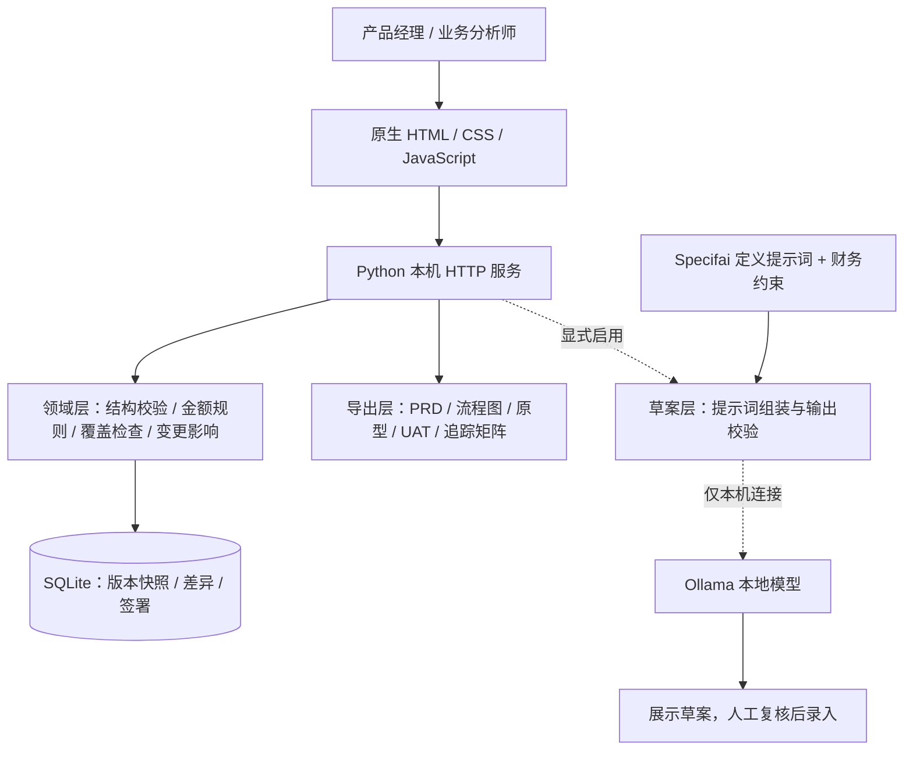

# Finance Product Agent · 财务产品需求与验收工作台

**把财务业务诉求，整理成有来源、有规则、可追溯、可验收的产品交付材料。**

Finance Product Agent 面向财务数字化产品经理、业务分析师和财务系统实施人员，将调研、需求澄清、流程、财务规则、PRD、页面原型与 UAT（用户验收测试）关联起来，并记录每次修改及其影响，让业务、产品和研发围绕同一份需求基线沟通。

项目采用 **Python 标准库 + SQLite + 原生 HTML/CSS/JavaScript**。核心功能无需第三方运行依赖、模型账号或 API Key；可选接入本机 Ollama 生成待复核草案。当前版本为单用户、本机运行的 MVP。

## 项目解决什么问题

财务系统建设的难点，往往是把“业务想要什么”变成“研发如何实现、业务如何验收”：访谈记录分散、金额口径不明确、制度依据缺失、PRD 与原型不同步，以及需求变化后仍沿用旧验收结果。

本项目用带稳定 ID 的业务对象，把这些材料连接起来：


适合财务流程改造的需求整理、ERP 或报销系统的前期方案评审、产品交付材料准备，以及财务产品设计方法的学习和展示。实际业务处理和验收执行仍在目标系统中完成。

## 项目功能

| 模块 | 已实现的能力 | 使用价值 |
| --- | --- | --- |
| 项目与调研 | 记录原始诉求、访谈来源、需求目标、责任人和成功指标 | 让需求有依据、有负责人 |
| 需求澄清 | 新项目生成六类待答问题，将问题与需求关联 | 暴露未明确的业务条件 |
| 流程建模 | 记录角色、输入、动作、输出与后续节点 | 便于跨角色沟通和交接 |
| 财务规则 | 记录制度依据、期间、币种、金额口径、舍入、职责分离及异常处理 | 将关键财务约束结构化 |
| 金额规则试算 | 使用 Decimal 进行金额与阈值比较，检查币种和适用日期 | 验证边界输入下的配置结果 |
| PRD 与原型 | 维护产品需求、页面字段和跳转，生成静态 HTML 可点击原型 | 连接业务描述与界面设计 |
| UAT 管理 | 关联需求、规则和页面，记录预期、实际结果、状态、执行人及证据 | 检查验收覆盖和执行情况 |
| 版本与追踪 | 追加保存版本、记录修改原因和对象差异、计算关联影响范围 | 回溯变化，避免旧页面覆盖新版本 |
| 签署检查 | 检查澄清、覆盖和 UAT 证据，人工签署绑定具体版本 | 明确需求基线的准备状态 |
| 交付包导出 | 导出 PRD、流程图、原型、UAT、追踪矩阵及版本证据 | 便于评审、归档与研发交接 |
| 可选 AI 草案 | 显式启用后，逐次调用本机 Ollama 生成待复核建议 | 辅助起草，正式内容由人确认 |

业务内容变化后，当前 UAT 执行结果会保守地全部重置为待执行，历史记录仍保留。任何新版本都会使旧签署不再适用于当前版本。

### 工作台预览

下图来自仓库已有的合成演示验证记录：


## 框架与架构设计

浏览器负责编辑与展示，HTTP 服务负责接口和访问校验，领域层负责规则、关联和版本，SQLite 保存工作区快照及签署记录。



| 层次 | 技术与文件 | 职责 |
| --- | --- | --- |
| 展示层 | `finance_agent/static/`；HTML/CSS/JavaScript | 表单编辑、导航、版本提示与结果展示 |
| 接口层 | `finance_agent/server.py`；`http.server` | 本机 HTTP 接口、Host/Origin 检查、CSRF 写入保护 |
| 领域与存储层 | `finance_agent/core.py`；`decimal`、`sqlite3` | 结构与引用校验、规则求值、版本冲突检查、签署检查 |
| 交付层 | `finance_agent/artifacts.py`；Markdown、Mermaid、HTML、CSV、ZIP | 从已保存版本生成交付材料 |
| AI 草案层 | `finance_agent/drafts.py`；`urllib`、Ollama | 澄清模板、提示词组装、本地模型检查与草案校验 |
| 验证层 | `tests/`；`unittest`、Node.js | 领域、HTTP、导出及网页行为回归 |

关键设计：

- **关联 ID 保持一致性**：来源、需求、流程、规则、PRD、页面和 UAT 之间建立引用；重复 ID、缺失引用和不匹配的需求范围会被校验。
- **草稿可逐步完善**：结构合法的未完成内容可以保存；未答问题、缺失制度依据、覆盖不足或无证据的 UAT 会阻止签署。
- **版本追加保存**：保存时提交版本号、操作者和原因；事务内检查版本，追加快照、差异及 SHA-256 摘要。
- **试算与验收执行分开**：规则试算验证配置，实际 UAT 结果、执行人和证据需要人工登记。
- **AI 默认关闭**：不启用模型也能使用核心工作台；建议不会自动覆盖正式需求。

详细数据模型、事务机制和技术取舍见 [架构说明](docs/ARCHITECTURE.md)。

## 与传统工作方式对比

以下以“使用 Word、Excel、原型工具并人工维护关联”的常见流程为参照，描述工作方式差异；未进行效率提升或成本节约的量化实验。

| 维度 | 传统文档与表格协作 | 本项目 |
| --- | --- | --- |
| 需求来源 | 在纪要、聊天和文档中人工查找 | 来源与需求通过 ID 关联 |
| 财务口径 | 自由文本记录，完整性依赖评审经验 | 提供规则字段，检查签署所需信息 |
| 材料一致性 | PRD、原型、测试表分别维护 | 从同一工作区维护关联并导出 |
| 变更管理 | 人工比对文件、通知相关人员 | 保存对象差异并计算关联影响 |
| 验收覆盖 | 人工核对需求与测试用例 | 检查需求、规则和页面的 UAT 覆盖 |
| 历史版本 | 依赖文件命名、共享盘或协作平台 | 追加保存版本、原因及签署记录 |
| 使用门槛 | 熟悉的通用工具，灵活度高 | 需要按结构化字段整理信息 |
| 团队协作 | 可借助成熟平台多人协同 | 当前仅支持单用户本机工作区 |

本项目适合补足需求追踪和验收准备这一环节。完整协作平台、专业原型工具及 ERP 的业务执行能力，仍由相应工具承担。

## 如何使用

### 1. 准备环境

- 安装 **Python 3.11 或更高版本**，确认 `python --version` 能正常运行。
- 下载本仓库 ZIP 并解压，或使用 Git 克隆本仓库。
- 在包含 `README.md` 和 `finance_agent/` 的根目录打开终端。
- 核心应用只使用 Python 标准库，无需运行 `pip install`。Node.js 仅用于开发验证，Ollama 仅用于可选 AI 功能。

### 2. 启动工作台

```powershell
python -m finance_agent.server
```

浏览器打开 **http://127.0.0.1:8765**。Windows 用户也可双击根目录的 `启动工作台.bat`，按提示访问地址。保持启动终端运行，结束时按 `Ctrl+C`。

端口被占用时可指定其他端口，并访问相应地址：

```powershell
python -m finance_agent.server --port 8766
```

### 3. 先体验合成演示

1. 在“项目概览”选择“载入合成演示”。
2. 填写底部的操作者和修改原因，点击“保存新版本”。
3. 查看“需求澄清”和“财务规则”，理解报销规则中的金额口径、币种、期间和阈值。
4. 在“页面与原型”查看已保存版本生成的页面及跳转。
5. 在 UAT 页面进行规则试算并查看验收状态；试算不会自动把用例标记为通过。
6. 点击“导出交付包”，查看 PRD、流程图、原型、验收表及追踪矩阵。

演示以“大额差旅报销复核”为例，`10000.00 CNY` 等阈值均为合成设定，不代表真实企业制度。已有工作区中不要直接载入演示并保存，以免把演示作为新版本覆盖当前内容；可使用独立数据库体验：

```powershell
python -m finance_agent.server --database data/demo.sqlite --port 8766
```

### 4. 建立自己的需求工作区

1. **项目概览**：填写项目名称、原始诉求及负责人。新项目默认标记为本地敏感数据。
2. **调研与需求**：登记来源、需求描述、负责人、成功指标，再逐项回答澄清问题。
3. **流程与规则**：定义角色、输入输出和步骤，补齐制度依据、期间、币种及金额口径等信息。
4. **PRD 与页面**：维护产品需求、页面字段、跳转和关联 ID。多选关联时按住 `Ctrl`。
5. **保存与评审**：填写修改原因并保存，检查已保存版本的原型、覆盖情况和阻塞项。
6. **UAT 与签署**：在实际交付系统中执行验收，再填写实际结果、执行人和证据；阻塞项清除后人工签署当前版本。
7. **导出与交接**：导出当前版本材料，交给研发或业务评审，并按需组织上线流程。

每个数据库管理一个工作区。不同项目请使用不同的 `--database` 路径；同时启动多个实例还需使用不同端口。

### 5. 导出哪些文件

| 文件 | 内容 |
| --- | --- |
| `PRD.md` | 产品需求文档 |
| `process.mmd` | Mermaid 流程图源码 |
| `prototype.html` | 可在浏览器打开的静态页面原型 |
| `UAT.csv` | 验收用例、执行结果和证据字段 |
| `traceability.csv` | 对象关联追踪矩阵 |
| `workspace.json` | 已保存版本的完整工作区数据 |
| `revision-evidence.json` | 截至导出版本的历史与版本证据 |

导出基于已保存版本，未保存修改不会进入交付包。材料包含完整业务内容和历史，应按实际数据敏感程度保存与分享。

## 可选：使用本地 AI 草案助手

该功能需自行安装并运行 Ollama，且准备好兼容的本地模型。基础工作台无需这一步。

先退出已有 Ollama 服务，在单独的 PowerShell 终端关闭其云功能并启动：

```powershell
$env:OLLAMA_NO_CLOUD='1'
ollama serve
```

在另一个终端启动工作台：

```powershell
python -m finance_agent.server --enable-local-ai
```

保存工作区，并在确认数据确为**完全合成或已脱敏**后设置对应分类。在“AI 草案助手”中填写已安装的模型名称，逐次点击生成，再人工复核建议。

服务只连接 `127.0.0.1:11434`，检查 Ollama 云功能关闭状态和本地 GGUF 模型元数据；不会自动下载模型、调用云 API 或把草案写入正式条目。不支持所需状态检查的 Ollama 版本、未知模型元数据或服务不可用时会返回错误。接口契约已有模拟测试，真实模型的生成质量尚未验证，详见 [本地模型边界](docs/research/ollama-boundary.md)。

## 目录结构

```text
finance-product-agent/
├── finance_agent/
│   ├── server.py          # 本机 HTTP 服务与启动入口
│   ├── core.py            # 领域校验、金额规则、版本与签署
│   ├── artifacts.py       # PRD、流程、原型及交付包导出
│   ├── drafts.py          # 澄清模板与可选本地 AI 草案
│   └── static/            # 网页界面
├── examples/demo.json     # 完全合成的差旅报销示例
├── tests/                 # Python 测试与网页行为回归
├── docs/                  # 架构、验证、边界与研究记录
├── vendor/specif-ai/      # 复用提示词、来源清单与许可证
├── 启动工作台.bat         # Windows 启动入口
├── NOTICE.md              # 第三方来源与复用声明
└── LICENSE
```

## 开发与验证

在项目根目录执行：

```powershell
python -W error::ResourceWarning -m unittest discover -s tests -v
python -m compileall -q finance_agent tests
node --check finance_agent/static/app.js
node tests/ui_regressions.cjs
```

测试覆盖金额边界、引用一致性、SQLite 版本冲突、签署失效、HTTP 写入保护、交付包导出及网页保存行为等。历史验证结果和具体范围见 [验证报告](docs/VALIDATION.md)。

## 当前边界与后续方向

- **本机单用户**：服务只监听 `127.0.0.1`，尚无多人账号、角色权限或云端协作能力。
- **规则范围有限**：目前执行单个非负金额与阈值的比较，支持 `>`、`>=`、`<`、`<=`、`==`，按 Decimal 四舍五入到分；汇率、税额、冲销和会计分录不在求值范围内。
- **原型用于沟通**：页面原型支持展示与跳转，未连接 ERP，也不执行真实审批、付款或记账。
- **签署用于基线记录**：操作者姓名是人工填写，尚无身份认证或密码学签名；哈希摘要便于比对，不提供文件所有者级防篡改保证。
- **数据由本机管理**：默认数据库为 `data/workspace.sqlite`，未加密。备份前停止服务再复制数据库。`data/`、`exports/`、`.env` 和 SQLite 文件已纳入 Git 忽略规则。

后续可扩展方向包括财务负责人确认与退回、按变更影响进行细粒度重验、规则冲突与适用主体建模、多币种处理及外部系统 UAT 证据导入。这些为规划方向，当前版本尚未实现。详见 [数据与安全边界](docs/SECURITY.md)。

## 来源与许可证

项目实际复用了 [Presidio Specifai](https://github.com/presidio-oss/specif-ai) 的 BRD、BP、PRD 定义提示词，固定来源提交、文件清单和版权声明均保留在仓库中。

复用范围为提示词文本；Python 领域逻辑和网页工作台由 Finance Product Agent 项目实现，未移植 Specifai 的 Electron、Angular 或 LangGraph 运行时。本项目与 Presidio 无官方隶属关系。

本项目代码见 [LICENSE](LICENSE)，第三方材料保留 [上游许可证](vendor/specif-ai/LICENSE)。来源细节见 [NOTICE](NOTICE.md) 和 [上游复用审计](docs/research/upstream-audit.md)。
