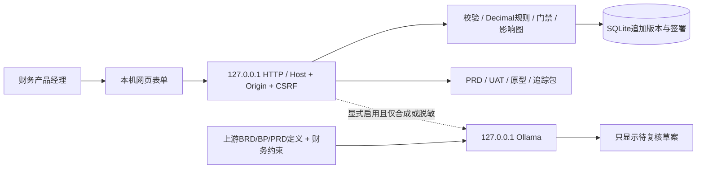

# 架构与选型

## 结论

采用 Python 标准库 + 本机 HTTP + SQLite 追加版本 + 无框架网页。上游提示词作为保留版权的 vendor 文本由运行时读取；不安装其 Electron/Angular/云 SDK/遥测依赖。这是受控的下游 MVP，不兼容导入上游项目目录，不声称复用了未复制的完整引擎。

## 领域模型

来源 SRC → 需求 REQ → 流程 FLOW / 规则 RULE → PRD → 页面 UI → 验收 UAT。需求有 owner/metric/source_ids；澄清 Q 关联需求，责任与来源从需求追溯。流程包含 role/input/action/output/next；分支条件写在动作中，首版不执行完整工作流。页面 actions 指向页面 ID，生成静态 hash 跳转。

所有 ID 唯一，所有引用必须有效，流程、规则与验收的需求范围必须一致；需求必须有来源、澄清和下游覆盖，规则与页面都须有 UAT。结构校验允许未完成草案保存，业务门禁对未答问题、空制度依据/期间、缺失覆盖、失败或无证据的 UAT 拒绝签署。

规则只执行一个非负金额与阈值的比较，支持 `> >= < <= ==`，按 Decimal 四舍五入到分。币种、期间不匹配直接转人工错误。职责分离/金额口径是可追溯的需求约束，原型不执行真实权限检查。汇率、税额、冲销、会计分录与合规判断不在本版规则求值范围。

## 版本与并发

每次保存输入 expected_version、actor、reason，在 SQLite `BEGIN IMMEDIATE` 事务内检查版本后追加 revisions；保存规范 JSON SHA-256、previous_digest、逐对象 before/after 与上下游传递影响。旧版本永不通过应用更新。删除是新版本缺少某节点，旧快照保留。业务变化保守清空全部当前 UAT 结果，以免错用旧证据；仅登记执行结果时保留其他用例记录。

approvals 独立追加，绑定确切 version。签署事务重新校验完整门禁；任何后续版本都不继承签署。人名是声明而非认证身份。哈希便于比对，不提供管理员/文件所有者防篡改保证。

## 依赖和上游复用

应用第三方运行依赖为 0；Python 使用 argparse/http.server/sqlite3/decimal/urllib/zipfile/unittest。上游的依赖版本、许可证差异与数据出口均见 research/upstream-audit.md。vendor 三份定义与其上游文本对应关系由 tests/test_artifacts_ai.py 验证其中关键内容，并记录 SHA-256 清单。

保持 HTTP、核心领域、文档导出、本地草案四个模块。没有增加微服务、向量库、自动多代理或任务队列。后续若需要接回 Electron，可将领域规则经受限本机接口连接，但现阶段不维护第二套界面。
