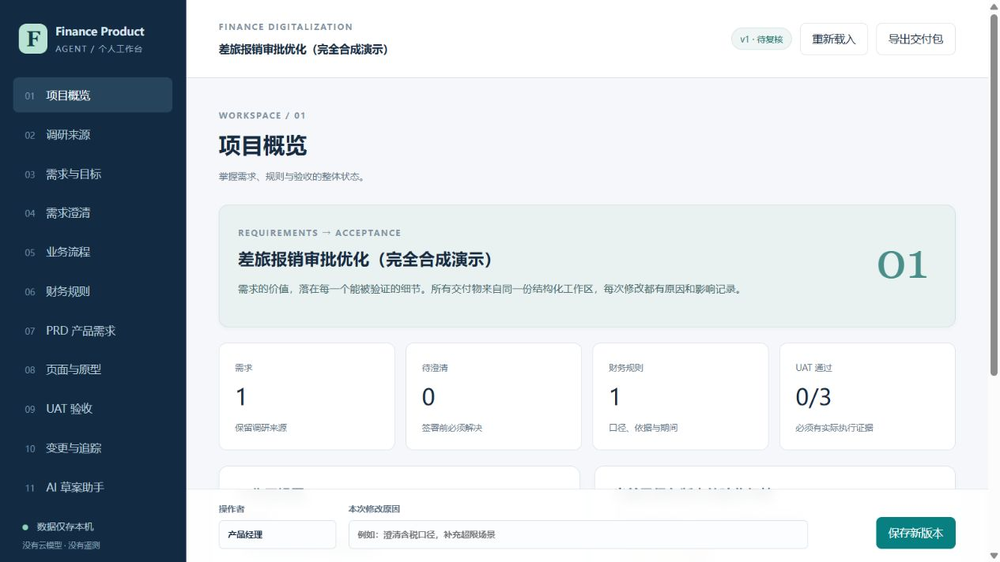

# MVP 验证证据

## 2026-10-22 发布前复验

环境：Windows，Python 3.14。重新执行全部 15 项 Python 测试与 4 项网页行为回归，均通过；Python 编译与 JavaScript 语法检查通过。本次同步重写项目介绍及使用说明，应用业务代码未变更。以下为原始开发验证记录，其中当时的仓库和发布状态不代表当前状态，现行说明见 [仓库与发布说明](REPOSITORY-PLAN.md)。

## 原始开发验证记录

日期：2026-10-21（Asia/Singapore）。环境：Windows，Python 3.14，Node 用于网页语法及行为回归；应用运行无需 Node。源码按 Python 3.11+ 编写，本次未在 3.11/3.12 环境重跑，不宣称跨版本矩阵已验证。

## 可复现检查

在仓库根目录执行：

```powershell
python -W error::ResourceWarning -m unittest discover -s tests -v
node tests/ui_regressions.cjs
node --check finance_agent/static/app.js
python -m compileall -q finance_agent tests
git diff --check main
```

结果：**15 项 Python 测试 + 4 项网页行为回归通过**；脚本语法、Python 编译与 Git 空白检查通过。原始输出见 [tests.txt](evidence/tests.txt)、[ui-regressions.txt](evidence/ui-regressions.txt)。最初 core 测试因模块未实现而失败，随后补齐实现；复核发现的问题均增加了会复现错误的行为回归。

| 范围 | 实际执行证据 |
| --- | --- |
| 金额 | 9999.99、10000.00、10000.005 舍入边界；浮点/NaN/无穷/负数/超长科学计数拒绝；币种及期间不匹配拒绝 |
| 关联 | 重复/缺失ID、跨需求虚假引用拒绝；需求/规则/页面UAT覆盖门禁；传递影响范围 |
| 版本 | SQLite真实写入与重开；旧版本冲突；不完整签署拒绝；完整记录签署；规则修改后UAT清空及签署失效 |
| 本机HTTP | 真正启动临时回环服务器与HTTP客户端；Host/Origin/CSRF拒绝；目录穿越404；合法保存、ZIP导出、原型响应、规则试算、AI未启用拒绝 |
| AI接口 | 模拟Ollama状态、模型元数据及输出；未启用/敏感分类不建连接；云启用、未知状态、重命名远程模型与未知模型在prompt发送前拒绝；严格草案字段 |
| 导出 | HTML脚本注入转义、CSV公式转义、7个包内文件、关联ID保留；新版本历史不混入旧版本导出 |
| 网页行为 | 使用实际app.js和延迟响应：在途新编辑保留、失效UAT不得恢复、自选模型不触发工作区修改、无效JSON导入保留原草稿 |

## 浏览器实测

启动本机工作台后，在真实浏览器完成：

1. 项目概览载入完全合成演示，填写修改原因并保存 v1。
2. 确认 UAT 0/3、三项未通过门禁，而非自动签署。
3. 打开财务规则表单，看到依据、币种、适用期间、金额口径、职责分离、阈值和分派结果。
4. 打开 `/prototype`，从“报销申请”点击“提交并查看复核”，URL 到 `#UI-2`，显示“财务复核”和“返回申请”。



浏览器验证不等于所有表单和设备尺寸已做自动E2E；没有宣称移动端矩阵、读屏器、外部ERP或真实财务UAT通过。

## 审查与限制

Standards 与 Spec 独立审查发现并修复：保存响应覆盖新编辑、JSON失败导入破坏草稿、模型名称误标为工作区修改、本机Ollama可能云转发、导出包含未来版本历史，以及在途编辑恢复旧验收证据。复核记录见 [REVIEW.md](REVIEW.md)。

未安装或运行上游全部 Electron/Angular 依赖；未做全依赖漏洞扫描。未调用真实 Ollama 或云模型，未验证生成内容质量。规则是合成金额分派配置，未作为真实财务政策。没有真实客户数据、部署、远端推送、PR或合并；GitHub仓库位置需用户确认。
